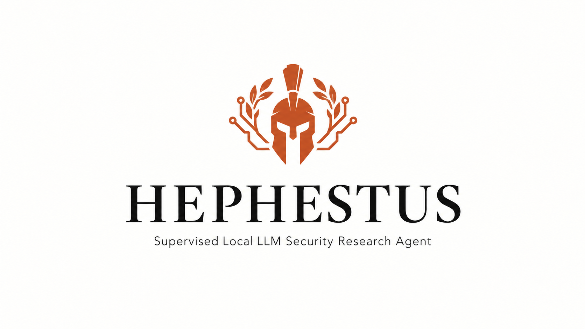
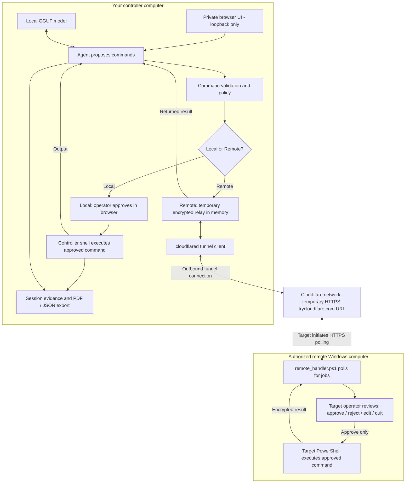
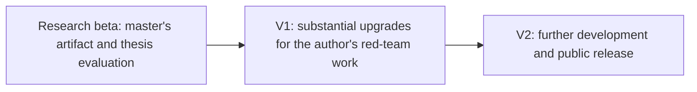

<p align="center">
  
</p>
<p align="center">
  
</p>

<h1 align="center">Hephestus V2.0</h1>
<p align="center"><strong>Local intelligence. Human approval. Inspectable evidence.</strong></p>
<p align="center">
  
  <a href="LICENSE"></a>
  <a href="#models-and-hardware"></a>
</p>
<p align="center">
  A supervised local LLM security research workspace<br>
  with a browser control room and optional encrypted remote execution.
</p>
<p align="center">
  <a href="#research-origins-and-project-evolution">Research origins</a> ·
  <a href="#quick-start-local-mode">Quick start</a> ·
  <a href="#remote-mode-another-windows-computer">Remote guide</a> ·
  <a href="#models-and-hardware">Models</a> ·
  <a href="#architecture">Architecture</a> ·
  <a href="#from-masters-research-to-v20">Beta → V1 → V2</a> ·
  <a href="#troubleshooting">Troubleshooting</a>
</p>

> [!CAUTION]
> **YOU NEED FULL AUTHORIZATION before launching or using Hephestus against any system.**
> Use it only for ethical security research on systems you own or have explicit
> authorization to assess. Agree on the targets, permitted actions and scope before
> starting. In Remote mode, the target operator must independently approve each
> proposed script on the target computer; permission to connect is not execution approval.

Hephestus loads a GGUF model on your computer, proposes commands for an authorized
security assessment, and records the proposals, operator decisions and results.
Run commands locally with browser approval, or connect an authorized Windows
computer using a generated PowerShell connection bundle. The model stays on the
controller in both modes. No cloud model account or API key is required.

**All controller operation happens in the web UI.** The terminal installs and
launches the application and displays server logs; use the browser to load models,
configure settings, connect a remote worker, start tasks, review local commands
and manage evidence. Remote command approval remains on the target computer.

Hephestus began as the software artifact for **Daryl Gatt's MSc in Cyber Security
at the University of Wolverhampton**. The dissertation, *Chains of Command: How
Agentic AI Alters Attacker Tactics, Techniques and Procedures* (2026), examined a
much earlier, less capable research beta. After the master's project, Hephestus
was substantially upgraded into **V1 for the author's red-team work**, then further
developed into **V2, the public release in this repository**.

**The dissertation evaluated the research beta—not V1 and not this V2 release.**
Its findings explain the project's origins and the lessons behind its development;
they are not performance results for the current application. Read the
[research background](#research-origins-and-project-evolution) or the
[detailed study summary](docs/RESEARCH-BACKGROUND.md).

This public version is shared for authorized security research, learning and
independent use under the MIT license. It is maintained as a personal portfolio
project, without a promise of active support or a managed security service. See
[maintenance and contributions](CONTRIBUTING.md).

---

## What you can do

| Think locally | Stay in control | Keep the evidence |
| :--- | :--- | :--- |
| Run compatible GGUF models on your hardware. | Review commands and direct the task in the browser. | Revisit sessions and export JSON or audit PDFs. |

- Load, unload and inspect compatible GGUF models from the model library.
- Choose **Local / Remote** directly in Workspace; each web launch starts Local.
- Use **Quick** for a small task or **Goal** for a bounded sequence of iterations.
- Review exact proposals, approve or reject them, update guidance, request a
  command edit and stop the run.
- Watch activity, command output and available GPU telemetry; tune model and run
  settings from the browser.
- Reopen saved sessions, rename or delete them, and ask the model about recorded
  evidence using the read-only **Ask the AI** panel.
- Export JSON and a generic **Cybersecurity Audit Evidence Report** PDF with
  timeline and event SHA-256 hashes.
- Open **Help** inside the application for the local and remote operating guides.

## Research origins and project evolution

### Why I developed Hephestus

I originally built Hephestus for my master's research to investigate what happens
when a language model can propose actions, use security tools and respond to their
results under mandatory human supervision. The practical question was how well
that combined model, framework and operator workflow could assist with security
tasks—and what the recorded evidence actually demonstrated.

The research beta separated planning, command interpretation, human approval,
execution and observation. This made the sequence from a model's proposal to a
tool's output inspectable. That distinction became a central lesson: a plausible
command, a successful process exit and an AI-generated completion message are
three different things, and none alone establishes that a security objective was met.

After the master's project, I substantially expanded Hephestus for my red-team
work as V1. V2 develops that work into a public application with local GGUF
inference, a browser workspace, Local/Remote execution, target-side remote
approval, model management, persistent sessions and evidence exports. The
work-use history describes my own development and use of the project; it does
not imply an employer endorsement or a published workplace evaluation.

### What the master's study examined

The dissertation's question concerned the effectiveness of a supervised LLM
agent on exploitation and post-exploitation tasks in a controlled vulnerable-VM
lab. Five scenarios covered Linux service enumeration, a root-shell objective,
protected-file access, Windows share/account enumeration and a privileged Windows
shell objective on **Metasploitable2 and Metasploitable3**.

The evaluated beta used **Qwen2.5-Coder-14B-Instruct, Q5_K_M GGUF**, served through
llama.cpp on an **NVIDIA RTX A5000 via RunPod**. That historical setup differs from
V2's controller-local inference and its optional, separate remote execution path.
The small 1.5B model offered by today's setup script was not the thesis model.

The analysis compared structured JSONL events, approval decisions and actual
command output against scenario criteria. The logbook had **25 trial entries**;
the retained evidence had **29 distinct run records**, including repeated trial
labels. The study therefore reported descriptive findings at run level, without
an overall success percentage or an assumption that all records were independent trials.

### What the beta results showed

| Study area | Finding reported in the dissertation |
| --- | --- |
| Linux service enumeration | All five relevant records contained the required port/version information; errors and unnecessary follow-up actions still occurred. |
| Windows share/account enumeration | Partial information was returned, but the combined shares-and-user-accounts criterion was not verified. |
| Exploitation and protected-file goals | Retained output did not verify a Linux root shell, the requested protected-file contents or a privileged Windows shell. |
| Windows access indicators | Some records verified authentication and tool-reported administrative access/share permissions; these were partial achievements, not proof of a privileged shell. |
| Reliability and measurement | Invalid syntax/options, unavailable tools, timeouts, refusals, repeated errors and unsupported completion signals showed why output needs independent interpretation. |

These findings describe the **earlier beta in its particular lab and operator
workflow**. They neither establish the performance of V1/V2 nor prove that a
human approval gate improves success or prevents every unsafe action. The study
had no unsupervised control or model comparison. Target isolation and snapshot
restoration were intended procedures, not outcomes independently verified by the
agent logs. An unverified goal also does not establish that a target was secure.

### Research influences and engineering lessons

The study drew on [ReAct (Yao et al., 2023)](https://arxiv.org/abs/2210.03629)
for iterative reasoning/action, [PentestGPT (Deng et al., 2024)](https://www.usenix.org/conference/usenixsecurity24/presentation/deng)
for modular security-agent design, [HackSynth (Muzsai et al., 2024)](https://arxiv.org/abs/2412.01778)
for agent evaluation context, and [Project Naptime (Glazunov and Brand, 2024)](https://projectzero.google/2024/06/project-naptime.html)
for the importance of tools and evaluation conditions. These are influences and
related work, not benchmarks that Hephestus has reproduced or surpassed.

The resulting engineering emphasis is on explicit approvals, visible command
output, bounded execution, useful failure reporting and inspectable evidence.
For a technical reader, the project brings together agent orchestration, Python
application design, shell/process handling, local model integration, authenticated
remote transport and careful outcome reporting. The
[detailed research background](docs/RESEARCH-BACKGROUND.md) explains the study,
its sources, limitations and the distinction between the three project stages.

## Quick start: Local mode

### 1. Requirements

Use Python **3.10+**; Python **3.12** is recommended for inference wheel availability.
Windows uses Windows PowerShell for local commands. POSIX systems use `/bin/sh`.
Installation and optional model downloads need internet access. Actual inference
runs locally after installation. Disk/RAM/VRAM requirements depend on your GGUF.
The optional quick-start model download is approximately **1.12 GB**, in addition
to the environment and dependencies.

### 2. Install

```powershell
git clone https://github.com/phantom0004/hephestus-redteam-agent.git
cd hephestus-redteam-agent
py -3.12 setup.py --download-model
```

If the Windows Python launcher is unavailable, use `python setup.py --download-model`
with a compatible installed Python. On Linux/macOS use `python3 setup.py --download-model`.

Setup creates `.venv`, installs dependencies, checks runtime imports and optionally
downloads the pinned official Qwen2.5-Coder-1.5B-Instruct Q4_K_M model. It verifies
the model size, GGUF header and SHA-256 before publishing the download. It does not
provision a remote connection or ship pre-generated keys.

| Setup option | Result |
| --- | --- |
| `python setup.py` | Install, then offer the optional model interactively. |
| `python setup.py --no-model` | Install without downloading weights. |
| `python setup.py --download-model` | Install and download the verified quick-start model. |
| `python setup.py --model-only --download-model` | Download only. |
| `python setup.py --venv PATH` | Use a different isolated environment directory. |
| `python setup.py --llama-backend cpu` | Select the CPU wheel source (default). |

Noninteractive setup skips the model unless `--download-model` is supplied. Existing
models and sessions are preserved by setup. External models retain their own licenses.

### 3. Start

```powershell
.\.venv\Scripts\python.exe .\start_hephestus.py
```

On Linux/macOS:

```sh
.venv/bin/python start_hephestus.py
```

The browser opens a private capability URL on loopback port **5000**. If it does not
open, copy the complete URL printed in the terminal. Keep that URL private. You can
also run `web.py` with `--no-browser`, `--port 5001` or `--config config.local.yaml`.
The startup launcher accepts the same options.

### 4. Load and run

1. Open **Models**, refresh if needed, and choose **Load** on your GGUF.
2. Wait for **Loaded**. No model is loaded automatically on server startup.
3. Return to **Workspace**. Leave **Local** selected.
4. Enter a harmless first task, such as `Print a greeting`, and choose **Quick**.
   Add the authorized scope/rules for your assessment when applicable.
5. Start the task and review the complete proposed command in the browser.
6. Approve selected commands, reject, update the instruction or abort. Nothing
   executes locally before the corresponding browser approval.
7. Inspect the output and export the session if needed. **Stop & disconnect**
   cancels the task; the model stays loaded until you unload it.

Local mode needs **no second computer, worker key, relay, cloudflared or tunnel**.
Commands execute using the controller account's permissions. Static policy checks
and optional model review support supervision; they do not isolate the shell.

## Remote mode: another Windows computer

The controller hosts the model, browser and temporary relay. The target runs a
PowerShell worker and asks its local operator to approve every proposed script.
PowerShell ISE is optional; a regular PowerShell window works too.

### Requirements by machine

| Controller | Authorized Windows target |
| --- | --- |
| Hephestus installed with a compatible local GGUF | Windows PowerShell 5.1 or later |
| `cloudflared` executable on PATH | Permission to run the supplied scripts under local policy |
| Network access for a Cloudflare Quick Tunnel | Outbound HTTPS to the temporary tunnel URL |
| Browser on the controller itself | An operator to review each proposed script |

The target does not need Python, a model, inbound firewall rules or administrator
rights. The worker runs with the account that launched it; permissions still limit
what it can do.

Install the optional tunnel client on the controller using the official
[Cloudflare downloads and installation guide](https://developers.cloudflare.com/cloudflare-one/networks/connectors/cloudflare-tunnel/downloads/).
On Windows with WinGet:

```powershell
winget install --id Cloudflare.cloudflared --exact
```

See the [Quick Tunnel guide](https://developers.cloudflare.com/tunnel/get-started/quick-tunnels/) for service limitations. Restart your terminal/application after installation so PATH is updated. The app
creates a disposable Quick Tunnel; no Cloudflare account or purchased domain is
needed for that mode. Third-party tunnel infrastructure carries encrypted relay
traffic and can observe connection metadata. Keep the operator UI private.

### Connect, step by step

1. Start Hephestus normally, load a model and stop any active task.
2. Select **Remote** in Workspace. The app creates fresh random keys, starts a
   memory-only loopback relay on an available port and requests a temporary HTTPS
   tunnel. Allow up to 25 seconds. Setup failure leaves Local available.
3. The app opens **Help**. Click **Download private connection ZIP**.
4. Transfer that ZIP securely to the authorized target and extract **all files**
   into one private folder. The bundle contains:

   ```text
   Connect-Hephestus.ps1    # launcher with this connection's temporary URL
   remote_handler.ps1       # supervised execution worker
   worker.key              # generated endpoint credential — private
   README.txt              # short connection instructions
   ```

5. On the target, open PowerShell in the extracted folder and run:

   ```powershell
   .\Connect-Hephestus.ps1
   ```

   Alternatively, open `Connect-Hephestus.ps1` in PowerShell ISE and press **F5**.
   The generated launcher supplies both the URL and key path; no manual key editing
   is needed. Follow your administrator's execution/signing policy if scripts are
   blocked.
6. Leave the worker running. On the controller, wait for **Remote worker connected**.
7. Start the task on the controller. The target displays the full proposed script
   and requests **Y** approve, **N** reject, **U** request an edit, or **Q** quit.
   Remote execution approval happens **on the target**, not silently on the
   controller. The browser continues showing task status and evidence.
8. To stop a task, use **Stop & disconnect**. To reconnect while the same remote
   session remains open, relaunch the same target script. To end the connection,
   choose **Local** or stop the controller server with **Ctrl+C**.
9. Delete the private ZIP and extracted files from both machines when finished.
   The app removes its own temporary controller keys during normal shutdown or
   when returning to Local. It cannot delete copies you downloaded or transferred.

Remote command timeout must stay below the relay job lifetime (240 seconds by default); the UI reports inconsistent settings before connecting. The worker retries its initial connection briefly while new tunnel DNS propagates.

The generated launcher includes the current command timeout and output capture limit. If you change those Settings, download a new bundle and relaunch the worker before the next task.

Each new Remote connection generates new credentials and a new endpoint. Old
bundles do not connect to a new session. The relay-only authentication key stays
on the controller and is **never included in the worker ZIP**. Treat the worker
bundle as a credential: anyone holding it can join that connection. There is one
worker and one in-flight encrypted job, with bounded expiry and replay checks.

The worker validates authorization again immediately before execution and attempts
to stop the command process tree after disconnection. Abrupt termination of the
controller or operating system can leave temporary files in the OS temp directory;
remove leftover `hephestus-remote-*` directories after confirming no session is
running. Do not assume cancellation reverses side effects already completed.

## Models and hardware

### Which model should I choose?

For a first run, use **Qwen2.5-Coder-1.5B-Instruct, Q4_K_M, GGUF** via the
verified setup download below. It is a small starting model for learning the
workflow, not a benchmark winner or a guarantee of reliable security advice.

For command generation, a **coding-focused Instruct or Chat model** is a sensible
starting point: it is trained for programming tasks and following instructions.
A capable general-purpose Instruct model can also work. Compare models on harmless
PowerShell or shell tasks relevant to your system; coding scores alone do not
measure command accuracy. Always review the proposed command before approving it.

| Filename term | What it means and what to choose |
| --- | --- |
| `Coder` / `Code` | A focus on programming; useful to consider for scripts and commands. |
| `Instruct` / `Chat` | Trained to respond to instructions. Prefer this over a Base or completion-only model. |
| `1.5B`, `7B`, `14B` | Approximate parameter count in billions. Larger models generally need more memory and compute; size alone does not guarantee quality. Start small and compare. |
| `Q4_K_M` | A compressed weight format; a practical starting balance of size and quality. |
| `Q5_K_M` / `Q8_0` | Less compressed alternatives needing more memory; consider them if supported and your hardware has room. |
| `.gguf` | The model file format used by this application's llama-cpp-python loader. |

**Download a complete, single-file, text-generation `.gguf` model supported by the
installed runtime, ideally with its instruction/chat template embedded.** A GGUF
extension alone does not guarantee compatibility. For this beginner workflow,
avoid split files such as `...-00001-of-00003.gguf`, adapter-only/LoRA downloads,
embedding/reranker models and vision projector files such as `mmproj*.gguf`.
Do not download `.safetensors`, PyTorch `.bin`, GPTQ, AWQ or EXL2 weights for direct
loading here. Renaming another format to `.gguf` does not convert it.

A suitable self-contained GGUF includes the weights and tokenizer information;
you normally do not need separate tokenizer/config files or the whole model
repository. Hephestus loads the file directly: Ollama, LM Studio, Transformers
and cloud inference accounts are not required. Some newer architectures, quantizations
or templates may need a newer runtime than this project's pinned version supports.

### Download and load: easiest option

From the project folder, run:

```sh
python setup.py --model-only --download-model
```

This downloads the pinned official quick-start model (approximately **1.12 GB**)
to `models/` and checks its size, GGUF header and SHA-256. Use
`python setup.py --download-model` instead if you also need to install dependencies.
The model has its own Apache-2.0 license; see its
[official model card](https://huggingface.co/Qwen/Qwen2.5-Coder-1.5B-Instruct-GGUF).

### Download and load: choose your own

1. Open [Hugging Face Models](https://huggingface.co/models). Search for a model
   family plus **Coder Instruct GGUF**, or start with the
   [official quick-start model's files](https://huggingface.co/Qwen/Qwen2.5-Coder-1.5B-Instruct-GGUF/tree/main).
2. Read the model card for its license, original publisher, supported runtime and
   hardware needs. Prefer the original publisher or an established converter that
   identifies the original model. Some repositories require sign-in or license acceptance.
3. Open **Files and versions** and download **one complete quantization**. For the
   quick-start example, select exactly `qwen2.5-coder-1.5b-instruct-q4_k_m.gguf`.
   Use the file's download control, not “Save page as”; do not download every quantization.
4. Wait for the full download to finish, then move the actual `.gguf` file into the
   project's `models/` folder. Do not leave a ZIP, `.part`, HTML page or tiny Git
   pointer file there. If the publisher provides a checksum, verify it. Manual
   downloads do not receive setup's pinned quick-start verification automatically.
5. Start Hephestus and open **Models → Rescan**. Choose the model's **Load**
   control and wait for **Loaded** before starting a task. To switch models, stop
   the task and eject the current model first.
6. Try **“Print a greeting”** in Local mode. Inspect the proposed command and
   approve it only after checking it. If output is garbled or instructions are
   ignored, check the model's chat template and runtime compatibility.

These folder instructions assume a source checkout. Installed packages use the
application data directory described under [Configuration and startup](#configuration-and-startup);
`HEPHESTUS_DATA_DIR` can select a different data directory. No model loads
automatically at startup, and Hephestus does not download arbitrary models from
Hugging Face through the Models screen.

### Memory, speed and compatibility

The downloaded file's size is **not** the total memory requirement. Allow extra
RAM/VRAM for the context (conversation and command history), inference buffers,
the operating system and the application. More context uses more memory. CPU
inference works but can be slow; GPU offload needs compatible drivers and the
correct inference backend. If memory runs out, try a smaller model, lower context
or batch size, or fewer GPU layers. Start with defaults and change one setting at
a time. Avoid choosing the largest model solely because it fits on disk.

See the [Hugging Face GGUF guide](https://huggingface.co/docs/hub/gguf) for file-format
background and the [llama-cpp-python documentation](https://llama-cpp-python.readthedocs.io/en/latest/)
for runtime and chat-template support. Model weights remain external downloads and
must stay out of Git and release archives.

The setup backend choices are `cpu`, `cu130`, `cu132`, `metal`, `vulkan` and `rocm72`.
Availability depends on upstream wheels, Python, OS and drivers; setup fails when
no compatible binary inference wheel exists. It does not silently compile a GPU
runtime. For example, select an appropriate CUDA backend only if your hardware and
runtime support it:

```powershell
py -3.12 setup.py --llama-backend cu130 --no-model
```

Use **Settings** for automatic GPU offload, manual layers, context, batch size,
threads, thinking budget, sampling and run limits. Lower context/batch size or
choose a smaller quantization if loading runs out of memory. GPU settings need a
matching inference build. Loader changes can reload the model; settings changes
are unavailable during an active task.

## Configuration and startup

No local YAML file is required for the browser quick start. For custom settings:

```powershell
Copy-Item config.example.yaml config.local.yaml
.\.venv\Scripts\python.exe web.py --config config.local.yaml
```

The terminal is a launcher and log viewer. **Tasks, approvals, model management,
settings and session controls are operated through the web UI.** The installed
`hephestus` entry point also launches the browser workspace; it does not accept
terminal task instructions.

For dry runs, configure `runtime.dry_run: true` in your YAML; the example
configuration enables it. Normal web startup uses Local even if an old YAML file
selects the relay; enable Remote from Workspace for a managed connection.
`relay.py` and `hephestus/worker/remote_handler.ps1` are protocol components used by the guided
remote connection. Follow the browser's connection guide rather than manually
configuring controller credentials. SSH from the original public release is not
a supported V2 execution backend.

Startup configuration precedence is explicit launch options → environment → YAML → defaults.
Relative YAML paths resolve beside that YAML file. Supported environment names and
validation rules are defined in `hephestus/config.py`. Browser model/run settings
are saved in the ignored `runtime-settings.json`; explicit environment/startup settings
for a control take precedence on restart. Connection mode and credentials are not
persisted in that file.

Source checkouts keep application data in the project folder. Installed packages
use the operating system's per-user Hephestus data directory. Set
`HEPHESTUS_DATA_DIR` before startup to choose a different private location for
models, sessions, saved settings and manually configured keys.

## Evidence, privacy and reports

Sessions live in `sessions/` under the controller's application data directory
(the project folder for a source checkout) and survive restarts. They can
contain goals, commands, target details and sensitive command output. Delete
unneeded sessions in the UI. Model weights, covers, credentials, local configuration,
settings and evidence are excluded by `.gitignore` and the source package allowlist.

PDF reports have a generic security audit cover with no employer logo, company
identity or confidentiality classification. They retain scope, runtime settings,
operator decisions, command evidence, captured output, timeline and hashes. Data
you supply or commands collect can still identify people or organizations;
review every export before sharing. Very large report output is clipped with a
notice; use JSON for the full captured evidence (capture itself has configured limits).

SHA-256 event chains and a timeline digest make exported evidence checkable for
later modification. They do not establish trusted timestamping, independently
prove provenance, or certify that the model achieved its objective. A zero exit
code or completion claim is not an independently verified security result.

## Architecture

The **controller** is the computer running Hephestus. Its GGUF model, browser UI,
agent and saved evidence stay there in both modes. Only the place where approved
commands execute changes.



| Component | Local mode | Remote mode |
| --- | --- | --- |
| Model and agent | Run on the controller | Run on the controller; no model on the target |
| Command approval | Controller browser | Target operator's PowerShell window |
| Command execution | Controller shell | Authorized target's PowerShell, with that user's permissions |
| Relay and tunnel | Not needed | Relay runs on the controller; cloudflared connects it to Cloudflare |
| Saved evidence | Controller's sessions folder | Controller's sessions folder; remote results return through the relay |

**Cloudflare supplies a temporary route to your relay, not a cloud model or a
hosted Hephestus server.** Selecting Remote starts a local relay and `cloudflared`
on the controller, creates fresh connection credentials and obtains a temporary
`https://...trycloudflare.com` address. The target's handler makes outbound HTTPS
requests to that address to fetch proposals and return results. The controller
browser UI stays private on loopback; it is not the service exposed by the tunnel.
See [Cloudflare's Quick Tunnel explanation](https://developers.cloudflare.com/tunnel/get-started/quick-tunnels/).

The application encrypts command/result payloads between controller and worker;
authenticated requests, replay checks and job expiry support the protocol.
Cloudflare still carries traffic and may observe connection metadata. Target-side
approval is required before a command executes. Returning to Local or closing the
controller ends the managed connection; a new Remote session needs a fresh bundle.
Quick Tunnels are intended for testing/development and have service limitations.

## From master's research to V2.0



| Stage | Purpose and scope | Evaluation status |
| --- | --- | --- |
| Research beta | Earlier, less capable university artifact; supervised agent loop and structured lab records; hosted 14B-model inference | The version evaluated in the dissertation |
| V1 | Substantially upgraded after the master's project for the author's red-team work | Not evaluated by the master's study; no workplace performance figures are claimed here |
| V2, this repository | Public browser workspace, local GGUF inference, Local/Remote workflows, managed connection bundles and inspectable evidence | Not evaluated by the master's study; historical beta findings are not V2 benchmarks |

The [previous repository baseline](https://github.com/phantom0004/hephestus-redteam-agent/tree/ecce96895471d7112e396add88fefcfd881341d5)
is useful code history. It is not a substitute for the dissertation's evaluated
beta or evidence that the current release reproduces its results. V2 uses a
supervised Windows handler for remote execution; SSH from the earlier code is
not a supported V2 execution backend.

See [CHANGELOG.md](CHANGELOG.md) for public-release changes and
[the research background](docs/RESEARCH-BACKGROUND.md) for the historical study.

## Troubleshooting

| Symptom | Action |
| --- | --- |
| Environment from another computer fails | Remove your local `.venv` and run setup using a compatible Python. Environments are not portable. |
| No compatible inference wheel | Try Python 3.12 and an OS/backend supported by the selected upstream wheel source. |
| No model loaded | Add/download an instruct GGUF, refresh Models and choose Load. |
| Model errors or memory exhaustion | Check template/architecture support; lower context/batch size or use a smaller model. |
| Remote setup says cloudflared is missing | Install the optional client on the controller, update PATH/restart and retry. |
| Remote never connects | Extract all files, run the generated launcher, check outbound HTTPS and synchronized clocks. |
| Tunnel expired or controller restarted | Select Local, then Remote, download and transfer the new bundle. |
| Switching is blocked | Stop the active task and wait for stopping to complete. |
| Worker script is blocked | Follow the target's approved script execution/signing policy. |
| Browser denies access | Use the complete private URL from the current server launch. |
| UI port is occupied | Run `start_hephestus.py --port 5001`. |

## Source layout and release hygiene

```text
hephestus/src/        Agent, policy, approval, execution and inference
hephestus/web/        Authenticated UI, sessions, reports, remote lifecycle
hephestus/relay/      Authenticated encrypted relay protocol
hephestus/web/static/ Browser workspace and built-in Help
models/README.md     External model provisioning guide
start_hephestus.py   Default local launcher
setup.py             Reproducible environment/model bootstrap
relay.py             Optional low-level standalone relay
hephestus/worker/     remote_handler.ps1: supervised remote PowerShell handler
docs/RESEARCH-BACKGROUND.md  Research origins, methods, findings and references
docs/assets/         README branding
```

Before publishing your own changes, inspect what will be staged: `.gitignore` does
not untrack files already committed. Never commit `.venv`, `secrets`, sessions,
connection ZIPs, model weights, local YAML, settings or exports. The V2 source
package uses an explicit allowlist; do not upload a ZIP of a used working folder.
See [CONTRIBUTING.md](CONTRIBUTING.md) for maintenance expectations.

**YOU NEED FULL AUTHORIZATION before launching or using this tool against any system.**
Use only on systems you own or are explicitly authorized to assess. Commands have
the executing account's permissions; supervision is not a sandbox. Review
[SECURITY.md](SECURITY.md) for boundaries, private reporting and dependency notes.
Code is [MIT licensed](LICENSE); external models and dependencies retain their own
licenses. No employer endorsement or affiliation is implied.
